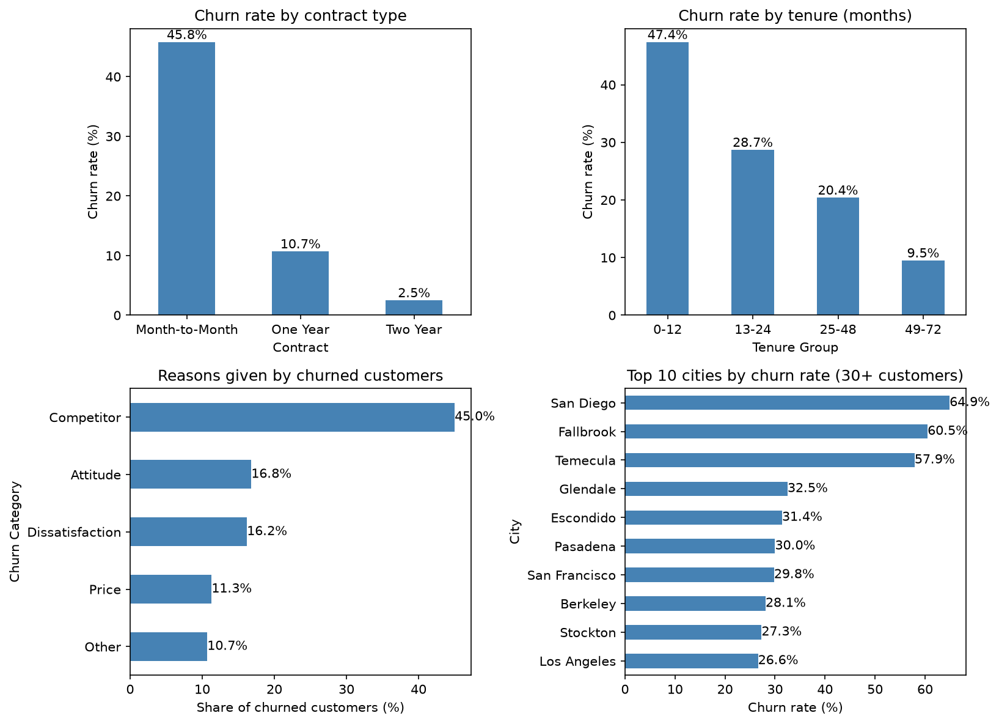

# Telco Customer Churn: Exploratory Data Analysis

An exploratory analysis of why telecom customers leave, built with Python (pandas, matplotlib).



## Project goal

Find which customer segments churn the most, when they leave, and why, so a retention team knows where to act first.

## Dataset

- IBM Telco Customer Churn dataset: 7,043 customers and 50 columns, covering one quarter.
- Target column: `Churn Value` (1 = left, 0 = stayed or joined this quarter).
- The dataset file is not included in this repository. Download it from its original source and place it next to the notebook.

## What I did

1. **Cleaning:** checked structure, missing values, duplicates and category consistency. Blank `Internet Type` values mean the customer has no internet service, so those rows were kept, not dropped.
2. **Outlier check:** applied the IQR rule to all numeric columns. The flagged values were genuine (sparse columns, skewed usage, rating scale), so no rows were removed.
3. **Churn vs features:** compared churn rates by contract, internet type, payment method, senior citizen status, gender, tenure and city using `groupby`.
4. **Churn reasons and value:** analysed the reasons given by churned customers and the customer lifetime value (CLTV) of churners.
5. **Follow-up checks:** confirmed the fiber optic and San Diego effects within each contract type.

## Key findings

- **Overall churn:** 26.5% (1,869 of 7,043 customers), or 28.4% if the 454 customers who joined this quarter are excluded.
- **Contract:** month-to-month churn is 45.8% vs 2.5% for two-year contracts. Month-to-month customers make up about 88% of all churn.
- **Tenure:** 47.4% churn in the first 12 months vs 9.5% after 4 years.
- **Fiber optic:** fiber churns more than DSL within every contract type (58.8% vs 33.3% on month-to-month). Month-to-month fiber customers alone make up about 59% of all churn.
- **Payment method:** credit card 14.5% vs mailed check 36.9%.
- **Seniors:** 41.7% churn vs 23.6% for non-seniors.
- **Gender:** no meaningful difference (26.9% vs 26.2%).
- **Reasons given:** 45% of churned customers cited a competitor, 17% staff attitude and 11% price.
- **San Diego:** 64.9% churn overall. Among month-to-month customers it is 82.0% vs 43.7% in other cities, and 82% of its churners cited a competitor.
- **Value:** churners have a slightly lower average CLTV (4,149 vs 4,491) and hold about 25% of total estimated lifetime value.

## Recommendations

- Offer incentives to move month-to-month customers onto longer contracts.
- Add onboarding and check-ins during the first year.
- Review fiber pricing, quality and competitor offers, especially on month-to-month plans.
- Run a targeted retention offer in the San Diego area.

## Limitations

- Findings are associations, not proven causes, and features overlap (for example, fiber and month-to-month).
- `Satisfaction Score` lines up almost perfectly with churn (every score of 1 or 2 churned, none of 4 or 5), so it was probably recorded after customers decided to leave. It was treated as an outcome, not a driver. `Churn Score` and `Churn Reason` have the same issue, so none of them should be used as predictors in a model.
- Churn reasons are self-reported, and 7% of churned customers answered "Don't know".
- The data covers a single quarter, so "churned" means left during that quarter.


## How to run

1. Install the libraries:
   ```bash
   pip install pandas matplotlib jupyter
   ```
2. Place the dataset file in the same folder as the notebook.
3. Open the notebook with `jupyter notebook` and choose Kernel > Restart & Run All.

## Author

Sarath Kumar Reddy | [LinkedIn](https://www.linkedin.com/in/sarathkumarreddy) | seellasharath2@gmail.com
